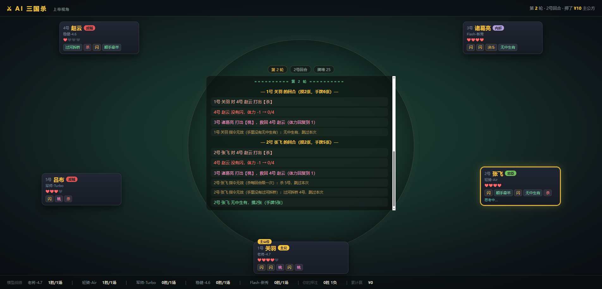
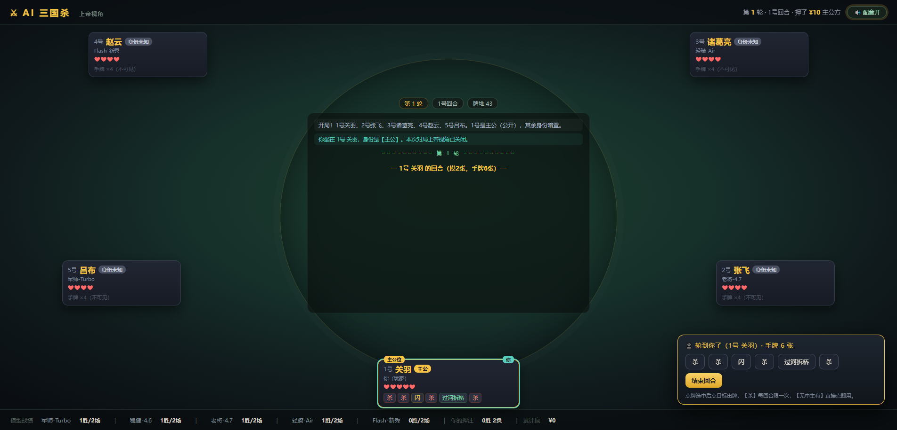
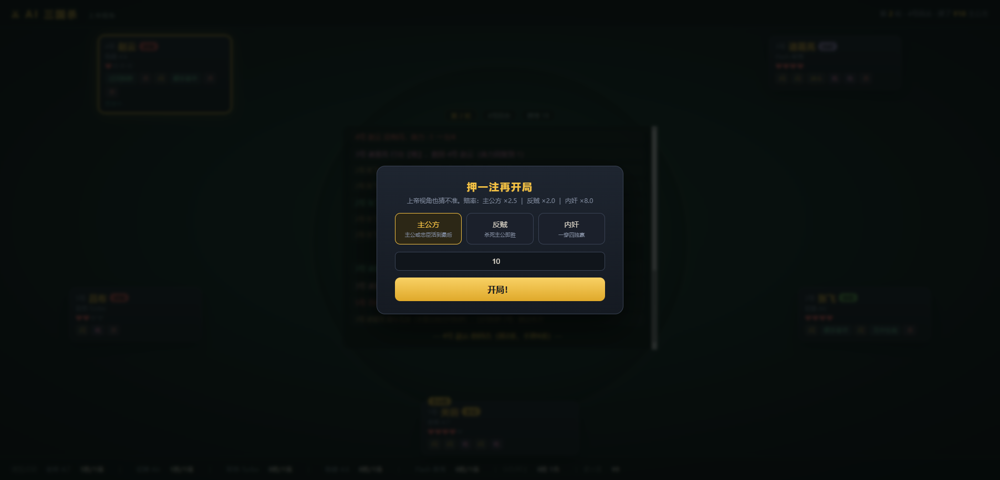

# AI 三国杀 · 上帝视角

5 个大模型打三国杀身份局（1主公 / 1忠臣 / 2反贼 / 1内奸），你在牌桌旁边开天眼围观，还能押注。

上帝视角能看到：每个人的真实身份、血条、全部手牌，以及每一张牌的流向。牌桌是整屏桌面布局，五座环绕，中间是实时战报，关键事件还有**中文语音解说**。



## 特性

- **桌面牌桌布局**：五芒环绕的座位、桌心实时战报、当前行动座位金色高亮，整屏不滚动（窄屏自动降级为纵向列表）
- **上帝视角**：身份、血量、手牌全公开，战报里连"谁拆了谁的什么牌"都写清楚
- **你也可以上桌**：开局前勾选「我也上桌」，选个座位（或随机）加入对局，你的手牌和身份只有你自己可见，其余人手牌隐藏、身份未知；出牌、响应（闪/桃/决斗）都在底部操作面板点选完成，**你的座位会固定旋转到最下方**；上帝视角随之关闭
- **语音解说**：调用浏览器自带语音合成（Windows/macOS 系统中文发声），出杀、闪避、吃桃、决斗、阵亡、胜负自动播报；右上角一键静音，开关状态记在 localStorage
- **押注**：开局前押阵营，主公方 ×2.5 / 反贼 ×2.0 / 内奸 ×8.0，战绩排行榜按模型累计
- **零依赖**：单文件 Node 服务 + 一个 HTML，不用 npm install



## 简化规则

- 60 张牌堆：杀×20、闪×15、桃×10、决斗×5、无中生有×5、过河拆桥×5、顺手牵羊×5
- 无装备、无距离、无判定阶段；主公 5 血，其余 4 血
- 濒死时任何人可出【桃】救；杀每回合限 1 次
- 胜负：杀死主公→反贼胜；反贼与内奸清光→主公方胜；主公被杀且场上只剩内奸→内奸独赢
- 10 轮上限，超时判平局（避免模型互相苟到天荒地老）

## 使用

```bash
git clone https://github.com/JOEH60/ai-sanguosha.git
cd ai-sanguosha
cp config.example.json config.json
# 编辑 config.json：给 5 个座位填 url / key / model
node server.js
# 浏览器打开 http://localhost:8901
```

开局前押一注：



> 语音需要浏览器先有用户手势才会发声（Chrome/Edge 自动播放策略）：打开页面后**点一下任意位置**即可，右上角按钮可随时开关。

## 接口

所有兼容 OpenAI `/chat/completions` 的服务都能用：GLM、DeepSeek、Ollama 本地模型（零成本）、OpenAI……

```json
{
  "port": 8901,
  "generals": ["关羽", "张飞", "诸葛亮", "赵云", "吕布"],
  "players": [
    { "name": "军师-Turbo", "url": "https://open.bigmodel.cn/api/paas/v4/chat/completions", "key": "sk-xxx", "model": "glm-4.7" }
  ]
}
```

`players` 必须恰好 5 个，身份随机分配，主公固定坐 1 号位。

## 模型怎么"看"游戏

模型只收到自己视角的信息：自己的身份、自己的手牌、全场公开信息（血量、手牌数、战报）。它需要用一行协议指令回话：

```
ACTION: 杀 3号
ACTION: 过河拆桥 4号
ACTION: PASS
```

被指定为目标时则回 `RESPOND: 出` 或 `RESPOND: 不出`。引擎会校验每条指令的合法性（有这张牌吗、目标在场吗、本回合杀过吗），非法指令记一条战报后跳过，不会污染游戏状态。

## 配套项目

- [AI 狼人杀上帝视角](https://github.com/JOEH60/ai-werewolf) — 6 个大模型互相骗

MIT License
